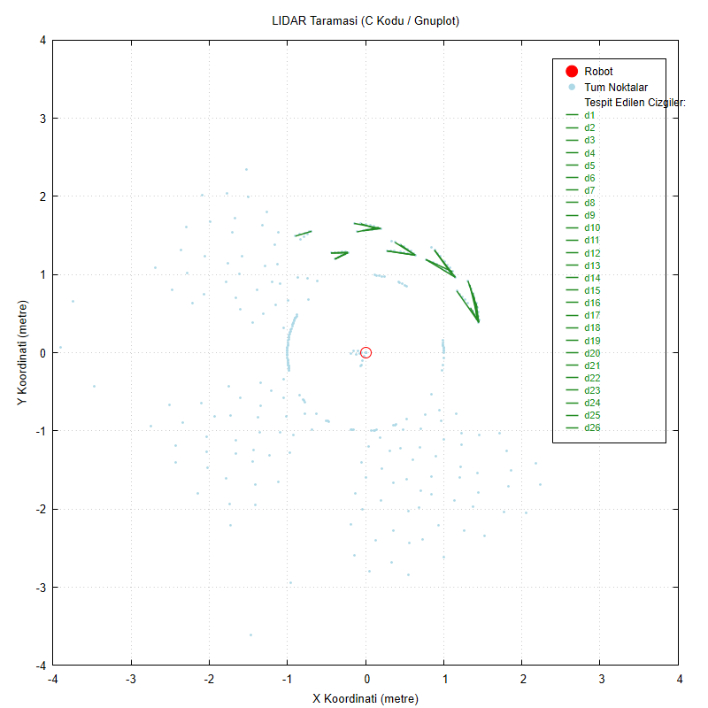

# LiDAR line detection with a Hough transform (C)

A C program that turns a 2D LiDAR scan into the straight wall segments a docking robot would see.

## Context

Coursework for the Programming Laboratory (Prolab) course, Computer Engineering, Kocaeli University - Fall 2025, project 1.

## What it does

- Parses a `.toml` scan file (angle range, increment, distance range, ranges list)
- Filters invalid readings and converts polar samples to x/y points
- Runs a Hough transform to find line segments
- Computes the angle between intersecting segments
- Writes a gnuplot script to draw points and detected lines

## Build / run

```
gcc main.c -o lidar -lm
./lidar
gnuplot commands.gp
```
Pick one of the sample scans (downloaded with `curl`) or the built-in test scan. gnuplot is needed to draw the result.

## Result

Built-in test scan (menu option 6), plotted with gnuplot: light-blue points are valid readings, green segments are the detected lines.



## Notes

No API keys, tokens or credentials are used or stored in this repository.
